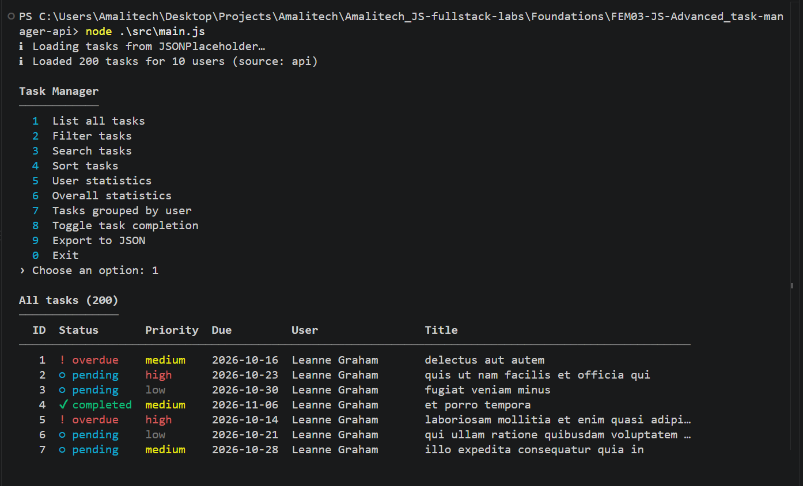
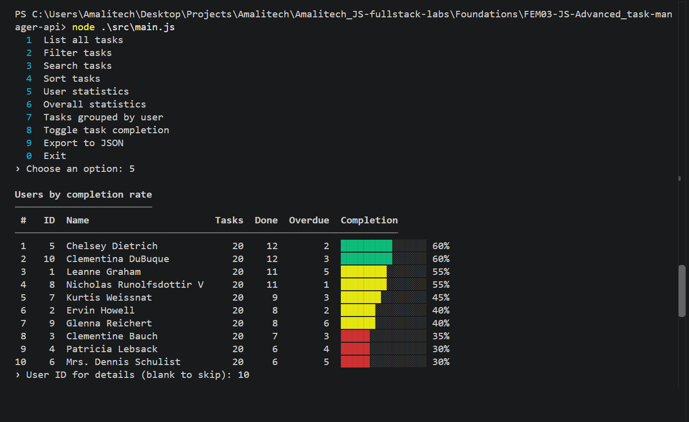

# Task Manager API Client

An ES6+ JavaScript client that fetches, processes and manages tasks from the [JSONPlaceholder](https://jsonplaceholder.typicode.com) API through an interactive CLI. Zero dependencies.

## Screenshots



## Getting Started
Requires Node.js 20+.
```bash
npm start
```
Set `DEBUG=1` to log requests, retries and cache hits.

**Menu:** list · filter (status / priority / user) · search · sort · user statistics · overall statistics · group by user · toggle task · export to JSON

## Architecture
```
JSONPlaceholder ──► APIClient ──► TaskManager ──► CLI
                    retry, cache,  models +        menu +
                    rate limit     processor       formatters
```
```
src/
├── api.js            # APIClient, APIError — fetching, retries, timeouts
├── models.js         # Task → PriorityTask, User
├── taskProcessor.js  # pure filter / search / stats / group / sort functions
├── TaskManager.js    # controller: loading, querying, toggling, export
├── cache.js          # closure-based TTL cache
├── rateLimiter.js    # promise-based request spacing
├── cli.js            # interactive menu
├── formatters.js     # tables, progress bars, colors
├── logger.js         # leveled logging
└── main.js           # entry point
```

`main.js` stays a thin entry point. The `TaskManager` controller (a bonus challenge) is the module that imports `APIClient`, the models and `* as processor` and connects them, so `main.js` only creates the manager, loads the data and starts the CLI.

**Derived data:** JSONPlaceholder todos only have `id`, `userId`, `title` and `completed`. `priority`, `dueDate` and `tags` are derived deterministically from the ids. Toggles are local only, because the API doesn't persist writes.

## Error Handling
- **Layered fallbacks:** retry with backoff → cached data → partial data if only one endpoint fails → on-disk snapshot (`.cache/`) → clear error and exit code `1`
- **Typed errors:** `APIError` distinguishes `network`, `timeout`, `http` and `parse` failures. Only transient ones are retried.
- **Bad data:** malformed records are skipped and logged. Empty responses, orphaned tasks and corrupt snapshots are handled.
- **Bad input:** invalid options, IDs, statuses or sort keys show a message and return to the menu.

## ES6+ Features
| Feature | Example |
|---|---|
| Classes, inheritance, private fields | `PriorityTask extends Task` overrides `getStatus()` via `super`; `#request()` |
| Async | `async/await` fetches; `.then()` chains with `Promise.all` in `fetchAll()` and `Promise.allSettled` in `fetchAllSettled()` |
| Destructuring | `const { id, title, completed, userId } = raw`; `({ priority }) =>` |
| Spread / rest | `{ ...task, ...derived }`, `[...tasks].sort()` / `addTask(...tasks)`, `sortTasks(tasks, ...criteria)` |
| Optional chaining | `company?.name`, `dueDate?.toISOString() ?? '—'` |
| Template literals, defaults | `` `${baseURL}${endpoint}` ``; `{ timeout = 5000 } = {}` |
| `map` / `filter` / `reduce` | `toModels()`, `filterByStatus()`, `calculateStatistics()` |
| `Map` / `Set` | `groupByUser()`, `getUniqueTags()` |
| Closures | `withCache()`, `createRateLimiter()` |

## Bonus Challenges
Implemented: closure caching, multi-criteria sorting (`'-priority', 'dueDate'`), a `TaskManager` controller, rate limiting and JSON export (`exports/`). The web UI was skipped to keep the focus on JavaScript.
