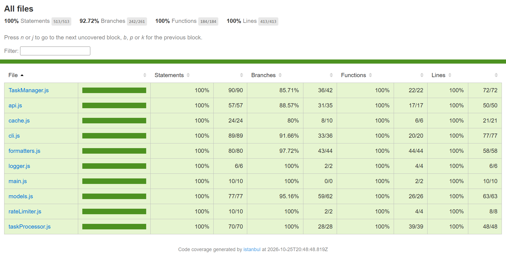

# Testing Documentation — Task Manager API Client

**191 tests in 9 test files, all passing. Coverage: 100% statements, 92.7% branches, 100% functions, 100% lines.**

```bash
npm test               # run all tests
npm run test:watch     # re-run tests when a file changes
npm run test:coverage  # run tests and show the coverage report
```

## Contents
1. [Testing Strategy](#1-testing-strategy)
2. [Test Types Implemented](#2-test-types-implemented)
3. [Test Coverage Analysis](#3-test-coverage-analysis)
4. [Challenges & Solutions](#4-challenges--solutions)
5. [Key Learnings](#5-key-learnings)
6. [Differences Between Test Types](#6-differences-between-test-types)

---

## 1. Testing Strategy

**My approach.** I tested the app in the same order the data moves through it: **API → models → processing → output**. I first tested each part on its own (unit tests). Then I tested the parts working together, with only the internet connection faked (integration tests). Most of my tests are unit tests, because they are fast and show exactly where a problem is.

**Why I chose this approach.**
- **I only faked things I can't control.** These are the network (`fetch`), the keyboard input (`readline`) and the clock. Everything else runs for real, so the tests check my actual code and not the fakes.
- **Tests give the same result every time.** Statuses like "overdue" depend on today's date. So I always pass a fixed date, use Jest's fake timers, or use dates far in the past or future. Tests also only write files to a temporary folder. This means the tests pass on any day and on any computer.
- **I test results, not internals.** Most tests check what a function returns, what error it throws, or what it prints. I only used spies when the call itself is what matters. Examples are checking the order of method calls, checking a log message, or checking that a subclass calls `super`.

**How I decided what to test.** For every public function or method, I asked four questions:
1. Does it work with normal input?
2. Does it work at the edges? For example: an empty list, 0% and 100%, the last second of a due date, or exactly 3 days before a deadline.
3. What happens with bad input, like `null`, `undefined`, the wrong type, or an unknown value?
4. What happens when something fails, like an HTTP error, a timeout, broken JSON or a missing file?

My first full version had 361 tests, which was too many and repeated a lot of checks. I cut it down to **191 tests** by combining tests that checked the same thing and removing duplicates. Every requirement is still met and coverage stayed almost the same (93.1% → 92.7% branches).

---

## 2. Test Types Implemented

### Test files

| File | Type | Tests | What it tests |
|---|---|---|---|
| `tests/setup.test.js` | Setup check | 3 | Jest is installed and working |
| `tests/unit/models.test.js` | Unit | 54 | `Task`, `PriorityTask`, `User` |
| `tests/unit/taskProcessor.test.js` | Unit | 35 | Filtering, statistics, grouping, search, sorting |
| `tests/unit/utils.test.js` | Unit | 22 | Array behavior, cache, rate limiter, logger (with spies) |
| `tests/unit/formatters.test.js` | Unit | 21 | How results are printed in the terminal |
| `tests/unit/cli.test.js` | Unit | 12 | The interactive menu |
| `tests/unit/main.test.js` | Unit | 5 | App startup and error messages |
| `tests/integration/api.test.js` | Integration | 20 | `APIClient` with a fake `fetch` |
| `tests/integration/dataFlow.test.js` | Integration | 19 | Full workflows through `TaskManager` |
| `tests/__mocks__/api.js` | Mock | — | Fake `APIClient` with sample users and todos |

There is one test file per source file, with two exceptions. `utils.test.js` covers the small helper modules together, as the brief asked. `TaskManager` is tested through the workflows in `dataFlow.test.js`.

### Unit tests (152)

| What I tested | Main test cases |
|---|---|
| **Task** (14) | Constructor and default values, null/undefined values, `toggle()`, `getStatus()`, `isOverdue()` (always false for a basic task), `fromAPI()` trimming the title and rejecting 4 kinds of bad data |
| **PriorityTask** (14) | Inheritance from `Task`, checking the priority is valid, overdue only after the due day ends, urgent within 3 days, which status wins (overdue > urgent > pending), the overridden `toString()`, `derive()` giving the same result every time |
| **User** (15) | Adding one or many tasks, rejecting null and other users' tasks, completion rate with 0 tasks (no division by zero) and rounding (33%, 67%), filtering tasks by status, reading nested API fields |
| **Model spies and errors** (11) | Methods calling each other correctly, bad constructor input, invalid due dates, tags that aren't an array, wrong types |
| **Processing functions** (35) | `filterByStatus`, `calculateStatistics`, `groupByUser`, `searchTasks`, `sortTasks`: 5 to 8 tests each, covering normal data, empty arrays, null input, bad parameters and special cases for each function |
| **Array behavior** (9) | Each function is run on a frozen array to prove it doesn't change the original. Spies check that `filter`, `sort` and `reduce` are used as expected. A filter → sort → map chain gives the right result |
| **Helpers** (13) | Cache expiry and fallback to old data, rate limiter spacing (with fake timers), logger levels and debug mode |
| **CLI, formatters, startup** (38) | Every menu option and wrong input, table and progress bar output, startup order and the exit code on failure |

> In the brief, `searchByProperty()` and `sortBy()` are mentioned. In my project these are called `searchTasks()` (searches titles and tags) and `sortTasks()` (sorts by one or more keys, with `-` for descending).

**Why these tests.** The models and processing functions contain the main rules of the app, so they have the most tests. The CLI, formatters and startup are tested enough to check that they work and to reach the coverage targets.

### Integration tests (39)

| Modules tested together | What is checked |
|---|---|
| `APIClient` + `fetch` + cache + rate limiter | Correct URLs, reading responses, caching, keeping partial results when one request fails, HTTP 404/500, network errors, timeouts, broken JSON, retrying, not retrying client errors |
| `TaskManager` + fake `APIClient` + models + processing + file system | The four workflows below |

**Workflows tested** (`dataFlow.test.js`):
1. **API → models:** raw users and todos become `User` and `PriorityTask` objects, each user gets their tasks, and a backup snapshot is saved.
2. **Models → search results:** filtering, searching and sorting return the right tasks, and bad search options are rejected.
3. **Models → report → export:** the statistics and user ranking are correct, toggling a task changes the next report, and the JSON export is saved in the right folder.
4. **API problems → fallbacks:** the app keeps working with partial data, loads the saved snapshot when offline, and shows a clear error when no data is available.

**How I used mocks here.** In `api.test.js` I used the real `APIClient` and only replaced `fetch`, so my response handling and error handling run for real. In `dataFlow.test.js` I replaced the whole `src/api.js` file with my mock in `tests/__mocks__/api.js`. That way `TaskManager` and everything below it runs for real, but without the internet.

### Mocks & spies

**What I mocked**

| What | How | Why |
|---|---|---|
| `fetch` | `jest.spyOn(globalThis, 'fetch')` with `mockResolvedValue` / `mockRejectedValue` | No real network calls, and I can fake any response or failure |
| `src/api.js` | `jest.unstable_mockModule` → `tests/__mocks__/api.js` | Workflow tests use fixed data I know in advance |
| `node:readline/promises` | `jest.unstable_mockModule` with prepared answers | Test the menu without typing on a keyboard |
| `TaskManager`, `CLI`, `APIClient` in `main.test.js` | `jest.unstable_mockModule` | `main.js` starts the app as soon as it is imported, so I had to replace what it uses |
| Time | `jest.useFakeTimers()`, `jest.spyOn(Date, 'now')` | Test cache expiry, rate limiting and retries instantly |
| File system | Real files in a temporary folder | Safe and simple, and never touches the project's `.cache/` or `exports/` folders |

In the mock data, I picked todo ids so the statuses stay the same on any date (2 overdue, 1 urgent, 2 pending, 4 completed). The mock also returns a fresh copy of the data on every call, so one test can't affect another.

**What I spied on**

| Spied on | What it checks |
|---|---|
| `isOverdue`, `isUrgent`, `Task.prototype.getStatus` | `PriorityTask.getStatus()` checks overdue first, stops early, and calls the parent with `super` |
| `Task.parse`, `PriorityTask.derive`, `User.prototype.addTask`, `Task.prototype.hasStatus` | Methods call each other with the right arguments and the right number of times |
| `Array.prototype.filter` / `sort` / `reduce` | The processing functions use the expected array method, and sorting is done on a copy |
| `console.log` / `warn` / `error` / `debug` | The logger uses the right icon and level, startup messages appear in order, errors are printed |
| `logger.warn` / `logger.debug` | Warnings for skipped records, partial data and offline mode; debug messages for cache hits and retries |

Spies are removed after every test with `mockRestore()` in `afterEach`. As a backup, `restoreMocks` and `clearMocks` are also turned on in the Jest config.

---

## 3. Test Coverage Analysis



| Metric | Target | Result |
|---|---|---|
| Statements | 80% | **100%** (513/513) |
| Branches | 75% | **92.7%** (242/261) |
| Functions | 85% | **100%** (184/184) |
| Lines | 80% | **100%** (413/413) |

The targets are set in `package.json`, so `npm run test:coverage` fails if coverage ever drops below them.

**How I improved coverage.** After writing the tests the brief asked for, my coverage was only **about 67%**. This was because `cli.js`, `formatters.js` and `main.js` had no tests at all. I could have excluded those files from the report, but I decided to test them instead:
- `formatters.js` only returns strings, so I tested it directly.
- For `cli.js`, I replaced `readline` with a fake that gives prepared answers.
- For `main.js`, I replaced its dependencies with mocks and imported a fresh copy in each test.

After that, I used the "uncovered lines" column of the report to add a few small checks, such as the `[✔]` mark for completed tasks and sorting by `userId`.

**Code I left uncovered on purpose (19 branches).** These are all default values for optional parameters:

| Where | Default value | Why I didn't cover it |
|---|---|---|
| `models.js` lines 73, 88, 93 | `now = new Date()` | My tests always pass a fixed date so results don't change from day to day |
| `TaskManager.js` lines 26, 28 | The real `.cache/` and `exports/` folders | Tests should never write files into the project |
| `cli.js` line 29 | The real keyboard and terminal | This would connect the tests to the real terminal |
| `TaskManager.js` 88, 134; `api.js` 9, 29, 64; `cache.js` 9; `formatters.js` 114 | Empty `{}` or `[]` defaults | The app always passes a value here, so the risk is very low |

No file is below 80% on any metric, and no tests are skipped.

---

## 4. Challenges & Solutions

**1. Jest would not run on my Windows computer.**
- **Problem:** Jest 30 uses a small native program that needs the Microsoft Visual C++ runtime, which wasn't installed. Every test run failed with a "module not found" error.
- **Solution:** I switched to Jest 29, which is written only in JavaScript and works on any computer.
- **Lesson:** a confusing error is sometimes caused by the computer setup, not the code. Testing the smallest piece on its own helped me find the real cause.

**2. Mocking with ES modules.**
- **Problem:** my project uses `"type": "module"`. In this setup, `jest.mock()` doesn't work the usual way, and the `jest` object isn't available automatically.
- **Solution:**
  - I run Jest with Node's `--experimental-vm-modules` option, and I hid the warning it prints so the test output stays clean.
  - I import `jest` from `@jest/globals`.
  - I use `jest.unstable_mockModule()` to replace a module, and import the code I'm testing *after* that.
  - For `main.js`, which runs straight away when imported, I used `jest.resetModules()` to get a fresh copy in each test.
- **Lesson:** with ES modules, you have to set up the mock before you import the code.

**3. Tests that depend on the date and time.**
- **Problem:** whether a task is overdue or urgent depends on today's date. The cache, rate limiter and retries depend on time passing. A simple test could pass today and fail next month.
- **Solution:**
  - My methods accept a `now` date, and my tests always pass a fixed one.
  - I used fake timers to skip waiting.
  - I picked mock data that gives the same statuses on any date.
- **Lesson:** code is much easier to test when you can pass in things like the current date instead of reading them inside the function.

**4. The coverage report was missing files.**
- **Problem:** at first, the report only showed files that a test imported. The setting `roots: ["tests"]` stopped Jest from seeing the `src/` folder.
- **Solution:** I removed `roots` and limited `testMatch` to the `tests/` folder instead.
- **Lesson:** check that the coverage report lists every file before trusting the numbers.

**5. Mocks remembering calls from earlier tests.**
- **Problem:** a shared `jest.fn()` kept counting calls from earlier tests, because in Jest 29 `restoreMocks` only resets `spyOn` spies. I also found that `mockRestore()` deletes a spy's recorded calls.
- **Solution:** I turned on `clearMocks` in the config. In the array tests, I save the spy's calls before restoring it.
- **Lesson:** it's important to know exactly what each Jest reset option does.

**6. Writing too many tests.**
- **Problem:** my first full suite had 361 tests. Many repeated each other, and some timing checks could fail on a slow computer.
- **Solution:** I combined related checks, removed duplicates and dropped the timing checks. I ended with 191 tests and almost the same coverage.
- **Lesson:** each test should check something that no other test checks. More tests doesn't always mean better tests.

---

## 5. Key Learnings

**Unit testing.** Small tests with clear names make it easy to see what broke. I also learned that testing edge cases finds more bugs than testing normal values. Examples are the last second of a due date, a user with 0 tasks, or 1/3 rounding to 33%.

**Integration testing.** All unit tests can pass even when the parts don't work well together. Integration tests showed me how the modules really combine. For example, when user data fails to load, the tasks are left without a user. Only replacing the network keeps these tests close to real use.

**Mocking and spying.**
- Mock the things you can't control, like the network, the keyboard and the clock, not your own code.
- Spies are useful for checking how functions call each other, such as call order, `super` calls and logging.
- Always restore spies after each test, and hide console output so the test results stay readable.

**How testing improved my code.** My tests found **three real bugs**. I fixed each one, and the tests now make sure they don't come back:
1. `PriorityTask.toString()` printed *"due no due date"* when a task had no due date.
2. An invalid due date was saved as `Invalid Date`. The task then showed as `pending`, and `toString()` crashed later. Now it throws a `RangeError` straight away.
3. Tags given as a string (`'work'`) were split into letters (`['w','o','r','k']`). Now this throws a `TypeError`.

Two tests also failed because *my test* was wrong, not the code: once I expected the wrong search result, and once I got the cut-off length of a long text wrong. This taught me that when a test fails, I should check the test as well as the code.

**Best practices I'll keep using.**
- Use `beforeEach` to set up fresh data for every test.
- Use fixed dates and temporary folders.
- Test one behavior per test.
- Check the exact error message, not just that an error happened.
- Freeze input arrays to prove a function doesn't change them.
- Set coverage targets in the config so they are checked automatically.

---

## 6. Differences Between Test Types

| | Unit | Integration | End-to-end (E2E) |
|---|---|---|---|
| **What it tests** | One function or class | Several modules together | The whole app, the way a user uses it |
| **What is real** | Only the code under test; the rest is faked | The real modules; only outside systems are faked | Everything (network, terminal, files) |
| **Speed** | Very fast | Fast | Slow |
| **When it fails** | Shows the exact function | Shows which connection broke | Shows that something broke, but not where |
| **Best for** | Rules, edge cases, input checks | Checking modules work together | The most important user actions |

**Examples from my project:**
- **Unit:** `PriorityTask.isOverdue()` returns `false` at `23:59:59.999` on the due date and `true` one millisecond later. No other module is involved.
- **Integration:** `TaskManager.load()` with the mock API turns raw JSON into `User` and `PriorityTask` objects, groups tasks by user and saves a snapshot. The models, processing functions, file system and manager all work together here.
- **E2E (done by hand):** running `npm start` with the real JSONPlaceholder API and using the menu. I didn't automate this, because it would need the real internet and could be slow or fail randomly. My integration tests cover the same steps with the network faked.

**When to use each:** write many unit tests for the logic, some integration tests for how modules connect, and a few E2E tests for the most important user actions. My project follows this: 152 unit tests, 39 integration tests, and E2E checks done by hand.
